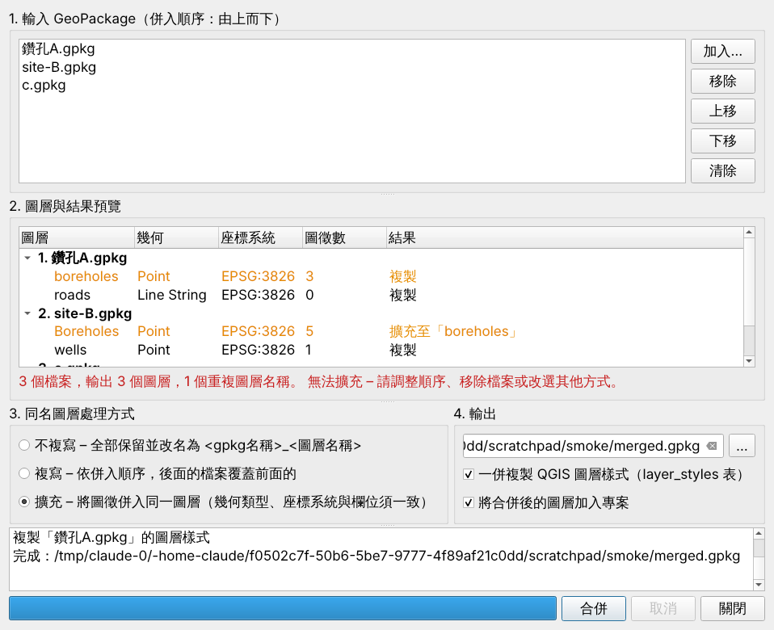

# GPKG Merger (QGIS plugin)

[繁體中文](#繁體中文) | [English](#english)



## 繁體中文

將多個 GeoPackage（.gpkg）合併為一個新檔的 QGIS 外掛。

### 功能

- **排定併入順序**：清單由上而下依序併入，可拖曳或用「上移／下移」調整；也能直接從檔案總管拖放 .gpkg 進來。
- **同名圖層處理**（名稱不分大小寫比對，與 SQLite 相同）：
  | 方式 | 結果 |
  |---|---|
  | 不複寫 | 全部保留，改名為 `gpkg名稱_圖層名稱`（若仍重名自動加 `_2`） |
  | 複寫 | 依併入順序，後面的檔案覆蓋前面的同名圖層 |
  | 擴充 | 圖徵併入同一圖層。先檢查**幾何類型、座標系統、欄位名稱與型別**，任何一項不符就停止、不寫入任何資料，並列出原因讓使用者重選 |
- **結果預覽**：合併前即可看到每個圖層會被複製、改名、覆蓋或擴充，不相容的圖層以紅色標示。
- **圖層樣式**：檔內 `layer_styles` 儲存的 QGIS 樣式會跟著圖層（含改名後的名稱）。
- **安全寫出**：先寫入暫存檔，全部成功才換成正式輸出；可隨時取消。
- **多國語言**：依 QGIS 介面語言（設定 ▸ 選項 ▸ 一般 ▸ 覆寫系統語系）自動切換：
  English、繁體中文、简体中文、日本語、한국어、Deutsch、Français、Español。
- 只使用 QGIS 內建的 GDAL/OGR，不需另外安裝套件。支援 QGIS 3.22 – 3.x 與 QGIS 4.x（Qt6）。

### 安裝

- **外掛管理員**：上架後於 QGIS「外掛 ▸ 管理與安裝外掛」搜尋 *GPKG Merger*。
- **ZIP 安裝**：到 [Releases](../../releases) 下載 `gpkg_merger-x.y.z.zip`，在「從 ZIP 安裝」選取。

使用：選單「向量 ▸ GPKG Merger ▸ 合併 GeoPackage…」或工具列圖示。

### 不處理的內容

網格／圖磚資料表與 QGIS 專案儲存表（`qgis_projects`）會略過並在記錄中說明。

## English

A QGIS plugin that merges several GeoPackages into a new one.

- Merge order set by drag & drop or Up/Down buttons (top is merged first).
- Layers with the same name (case-insensitive) are either **renamed** to
  `<gpkg name>_<layer name>`, **overwritten** (later file wins) or **appended**
  into one layer. Before appending, geometry type, CRS and fields are checked; if
  anything differs, nothing is written and the reasons are listed so you can
  change the selection.
- Preview of the result for every layer, layer styles follow their layers,
  output is written to a temporary file first, cancel at any time.
- The UI follows the QGIS language: en, zh_TW, zh_CN, ja, ko, de, fr, es.

## Development

```
gpkg_merger/            the plugin (copy/symlink into your QGIS profile's python/plugins)
  merge_core.py         merge engine – GDAL/OGR only, no Qt
  dialog.py, plugin.py  user interface
  i18n/                 .ts sources and compiled .qm translations
scripts/translations.py translation table (edit here)
scripts/build_i18n.py   check strings, write .ts, compile .qm (needs lrelease)
scripts/package.py      build dist/gpkg_merger-<version>.zip for plugins.qgis.org
tests/                  unit tests:  python -m unittest discover tests
```

Adding a language: add its code to `LANGS` in `scripts/translations.py`, add a
column to every entry, add it to `SUPPORTED` in `gpkg_merger/i18n_util.py`, then
run `python scripts/build_i18n.py`.

## License

GPL-2.0-or-later
